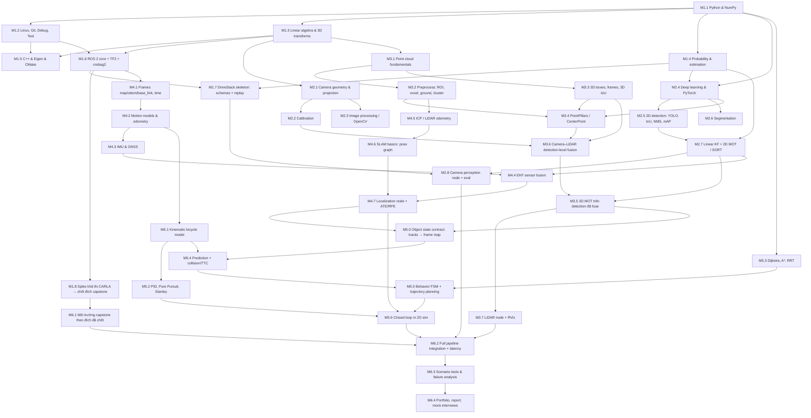

# DEPENDENCY GRAPH — kiến thức nối với nhau thế nào

> Bước 2 của master prompt. Mũi tên `A --> B` nghĩa là **phải vững A trước khi học B**. Module ID khớp với `ROADMAP.md` và `MODULE_GATES.md`.
> Biểu đồ Mermaid hiển thị trên GitHub/VS Code (cài extension Markdown Preview Mermaid nếu chưa thấy).

## 1. Đồ thị tổng quan

## 2. Các chuỗi xương sống (critical paths)

Nếu thiếu một mắt xích, mọi thứ phía sau sẽ "chạy được nhưng sai" — loại lỗi khó tìm nhất.

| Chuỗi | Vì sao quan trọng |
|---|---|
| **Transforms (M1.3) → Projection (M2.1) → Calibration (M2.2) → Camera–LiDAR fusion (M3.6) → 3D perception (M3.7)** | Mọi phép nối dữ liệu đa cảm biến đều là nhân ma trận transform. Sai quy ước một lần là lệch toàn hệ. |
| **Transforms (M1.3) → TF2 (M1.6) → Frames (M4.1) → Odometry (M4.2) → EKF (M4.4) → Planning/Control (M5.x)** | Planner lập kế hoạch trong frame `map`; nếu pose sai, quỹ đạo đúng về toán vẫn đưa xe đi sai. |
| **Probability (M1.4) → Linear KF (M2.7) → 3D MOT (M3.5) → EKF (M4.4)** | KF xuất hiện ba lần: tracking 2D, tracking 3D, localization. Hiểu một lần cho đúng, dùng ba lần. |
| **Detection (M3.4) → Fusion (M3.6) → 3D Tracking (M3.5) → Object state (M5.0) → Prediction (M5.4) → Behavior (M5.5)** | Prediction cần vận tốc **tuyệt đối theo mét trong frame map**; vận tốc đến từ tracking, chỉ đúng khi đã bù ego-motion (M5.0). |
| **Localization (M4.7) → Object state (M5.0)** | Đưa object về `map` cần pose ego tại đúng `stamp` của detection. |
| **Timestamp & clock (M1.6, M1.7) → Sync (M2.8, M3.6) → Latency (M6.2)** | Ở 20 m/s, 100 ms trễ = 2 m sai vị trí. Data time, steady time, system time không được trộn (`PROJECT_ARCHITECTURE.md` §3.1). |

## 3. Bảng "sai ở đây thì hỏng ở đâu"

| Module | Input → Output | Ai dùng output | Nếu sai thì phía sau hỏng thế nào |
|---|---|---|---|
| M1.3 Transforms | điểm/pose ở frame A → frame B | Gần như mọi module | Box lệch, point cloud chồng sai lên ảnh, pose nhảy, planner tránh vật cản "ma" |
| M1.7 Schemas & replay | dataset → message có timestamp/frame/unit | Mọi module | Đơn vị lẫn lộn (độ vs rad, ms vs s), dữ liệu không đồng bộ, test không tái lập được |
| M2.1–M2.2 Camera model & calib | ảnh checkerboard → K, distortion, extrinsic | Projection, fusion, IPM, đo khoảng cách | Project LiDAR lệch vật thể; ước lượng khoảng cách bằng camera sai theo độ sâu |
| M2.5 2D detection | ảnh → box + class + score | Tracking, fusion | FN → mất track, prediction không có vật cản; FP → phanh gấp vô cớ |
| M2.7 / M3.5 Tracking | detections theo thời gian → track ID + trạng thái (vị trí, vận tốc) | Prediction, behavior | ID switch → lịch sử quỹ đạo đứt; vận tốc ước lượng sai → TTC sai |
| M3.1–M3.2 Point cloud preprocess | raw cloud → cloud đã lọc, ground, cluster | 3D detection classic, ICP | Ground removal sai → mất người đi bộ thấp hoặc tạo vật cản giả |
| M3.3 3D boxes | label/prediction → box 7-DoF trong frame chỉ định | Eval, tracking, fusion | Sai quy ước yaw/frame KITTI → AP gần 0 dù model đúng |
| M3.4 3D detection | point cloud → box 3D + score | 3D MOT, fusion, planning | Bỏ sót vật thể xa/thưa → planner không thấy vật cản |
| M3.6 Fusion | box 2D + cloud + extrinsic + time → object hợp nhất | Tracking, planning | Lệch thời gian → ghép nhầm vật thể khi xe/vật đang chạy |
| M4.4 EKF | IMU/GNSS/odom → pose + covariance | Planning, control, map | Covariance quá tự tin → bỏ qua đo mới, drift không sửa được |
| M5.0 Object state | Track 3D + `EgoState` + TF → `ObjectState` trong `map` | Prediction, planning | Không bù ego-motion → vật đứng yên "chạy" với vận tốc ngược ego → phanh ma hoặc bỏ sót nguy cơ; dùng object cũ → TTC sai |
| M5.1 Vehicle model | lệnh lái → trạng thái kế tiếp | Control, planning, prediction | Quỹ đạo không khả thi động học, controller dao động |
| M5.2 Control | quỹ đạo + pose → steer/accel | Xe/simulator | Dao động, overshoot, vượt giới hạn lái |
| M5.5 Planning | map + objects + prediction → trajectory | Control | Va chạm, vi phạm ràng buộc, đứng yên không cần thiết |

## 4. Phụ thuộc chéo đáng chú ý

- **Linear KF được dạy ở M2.7** (vì SORT cần) với đầy đủ predict/update; **M4.4** mở rộng lên EKF. Không dạy EKF khi chưa qua gate M2.7.
- **M3.6 Fusion** cần cả nhánh camera (M2.2) lẫn nhánh LiDAR (M3.3, M3.4) — điểm hội tụ của Phase 2 và 3. Fusion ở mức **detection**, rồi **một** 3D tracker (M3.5) chạy trên kết quả fuse; track 2D pixel của Phase 2 không ghép ID vào track 3D.
- **M1.8** (spike CARLA, ngay sau gate M1.6) quyết định đích capstone sớm; Phase 6 không chờ tới tuần 22 mới biết simulator có chạy được không.
- **M5.6** dùng localization từ Phase 4; nếu Phase 4 chưa đạt, dùng **stub pose từ ground truth sim, ghi rõ `provenance=ground_truth`** — không được báo cáo như kết quả localization thật.
- **ROS 2 (M1.6)** là điều kiện để mọi module trở thành node; logic thuật toán viết thuần Python/C++ trước, bọc thành node sau (dễ test hơn).
