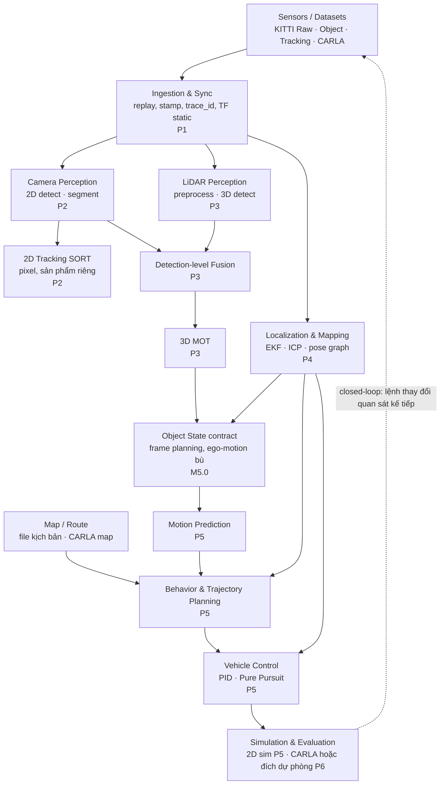

# PROJECT ARCHITECTURE — DriveStack Lab

> Bước 4 của master prompt. **DriveStack Lab — Modular ADAS & Autonomous Driving Learning System**: một hệ thống duy nhất, lớn dần qua 6 phase. Code nằm ở `drivestack/`: package được **khởi tạo ở M1.1**, mở rộng thành skeleton ở M1.7 (bạn tự viết phần lõi).
> Sửa đổi 2026-11-04 theo `ROADMAP_REVIEW.md`: ranh giới fusion/tracking, contract object state (M5.0), đo thời gian theo clock domain, đích capstone.

## 1. Kiến trúc tổng thể



**Ranh giới fusion/tracking (baseline):** fusion ở mức **detection** → một 3D tracker duy nhất. Track 2D (pixel) của Phase 2 là sản phẩm riêng để đánh giá camera, **không** ghép ID vào track 3D và **không** dùng cho TTC theo mét.

## 2. Module theo phase

| Module | Phase xây | Trước khi có (stub/mock) | Input | Output |
|---|---|---|---|---|
| `core` (types, frames, transforms, time, log) | 1 (M1.1 khởi tạo, M1.7 mở rộng) | — | — | Thư viện dùng chung |
| `io` (dataset readers, replay) | 1 | — | KITTI Raw | `ImageFrame`, `PointCloudFrame`, `OxtsFrame`, `Calibration` |
| `perception.camera` | 2 | Box từ label GT (`provenance=ground_truth`) | `ImageFrame` | `Detection2DArray` |
| `tracking.track2d` | 2 | — | `Detection2DArray` | `Track2DArray` (pixel) |
| `perception.lidar` | 3 | Box từ label GT | `PointCloudFrame` | `Detection3DArray` |
| `perception.fusion` | 3 | LiDAR-only (bỏ qua camera) | 2D + 3D + `Calibration` | `Detection3DArray` (fused) |
| `tracking.track3d` | 3 | Track = detection (không ID) | `Detection3DArray` (+ `EgoState` khi có) | `Track3DArray` |
| `localization` | 4 | Pose từ OXTS (`provenance=ground_truth`*) | IMU/GNSS/odom, cloud | `EgoState` + TF |
| `object_state` | 5 (M5.0) | — | `Track3DArray`, `EgoState`, TF | `ObjectStateArray` (frame planning) |
| `prediction` | 5 | Constant velocity | `ObjectStateArray` | `PredictedObjectArray` |
| `planning` | 5 | Đi thẳng theo làn, tốc độ cố định | `Route`, predictions, `EgoState` | `Trajectory` |
| `control` | 5 | — | `Trajectory`, `EgoState` | `ControlCommand` |
| `sim` | 5 (2D closed-loop) → 6 (CARLA hoặc dự phòng) | Replay (open-loop) | `ControlCommand` | trạng thái xe, sensor data |
| `eval` | 2 → 6 | — | output + GT/reference | metric reports |

\* OXTS là **reference** (GPS/IMU đã kết hợp), không phải ground truth tuyệt đối — báo cáo ghi "so với OXTS".

## 3. Quy ước bắt buộc

**Đơn vị:** SI — mét, giây, radian, m/s, m/s². Góc **luôn** radian trong code; độ chỉ ở config có hậu tố `_deg`, đổi ngay khi load.

**Frames (REP-103 / REP-105):**

| Frame | Định nghĩa |
|---|---|
| `map` | Cố định toàn cục, ENU (x Đông, y Bắc, z lên). **Frame planning mặc định** |
| `odom` | Liên tục, trôi dần; không nhảy |
| `base_link` | Gắn xe: x trước, y trái, z lên; gốc tại tâm cầu sau |
| `velodyne` / `lidar_top` | Frame LiDAR (KITTI: x trước, y trái, z lên) |
| `camera_front` | Thân camera (x trước, y trái, z lên) |
| `camera_front_optical` | Optical: **x phải, y xuống, z trước** — K áp dụng ở frame này |

**Ký hiệu transform:** `T_a_b` biến điểm **từ frame b sang frame a**: `p_a = T_a_b @ p_b`; ghép `T_a_c = T_a_b @ T_b_c`.

**Provenance:** mọi output có `provenance ∈ {model, ground_truth, mock}`; metric chỉ dùng `model`; visualization phân biệt màu theo provenance. Mọi kết quả ghi rõ **simulation / replay / real**.

**Mảng:** point cloud `(N, 4) float32` = x, y, z, intensity. Ảnh `uint8 (H, W, 3)` BGR — ghi rõ khi đổi sang RGB.

### 3.1 Thời gian — ba clock domain, không trộn

| Clock | Nguồn | Dùng cho | Không dùng cho |
|---|---|---|---|
| **Data/ROS time** | Timestamp cảm biến trong dataset; `/clock` khi replay hoặc sim (`use_sim_time`) | `header.stamp_ns`, TF lookup, tracking, fusion, đồng bộ | Đo thời gian tính toán |
| **Steady clock** | `time.monotonic_ns()` / `std::chrono::steady_clock` — đơn điệu, chung cho mọi process **trên cùng máy** | Đo thời lượng xử lý và latency pipeline | Gắn vào dữ liệu, so giữa nhiều máy |
| **System clock** | Giờ hệ thống (có thể nhảy do NTP) | Log cho người đọc | Mọi phép đo |

- `stamp_ns` = thời điểm cảm biến chụp/quét (data time). Không bao giờ ghi đè bằng thời điểm nhận/xử lý.
- Mỗi input do replay/sim phát ra mang `trace_id` (định danh duy nhất); các output sinh ra từ nó mang lại `trace_id` đó.

**Ba đại lượng đo, báo cáo riêng:**

1. **Processing duration** (của một module) = `end_steady − start_steady`, đo trong cùng process.
2. **Pipeline latency** (replay/sim → output) = `t_steady(output nhận tại observer) − t_steady(input được phát)`, ghép theo `trace_id`, cả hai mốc lấy bằng steady clock trên **cùng máy**. Nhiều máy: phải đo tại một đầu mối hoặc quy định đồng bộ clock trước.
3. **Data age / sync error** = chênh lệch `stamp_ns` trong cùng data/ROS time domain (vd. ảnh vs scan LiDAR được ghép; tuổi của `ObjectState` khi planner dùng). Ghi kèm **replay rate**.

Báo cáo: p50/p95 latency, throughput (Hz), tỷ lệ drop, và **real-time factor** khi chạy sim. Sim ở synchronous mode chỉ chứng minh tái lập, không chứng minh real-time.

## 4. Schema message (bạn tự cài `dataclass` trong `drivestack/core/types.py` [TỰ VIẾT])

| Type | Trường chính |
|---|---|
| `Header` | `stamp_ns: int` (data time), `frame_id: str`, `seq: int`, `trace_id: str` |
| `ImageFrame` | `header`, `image: (H,W,3) uint8`, `camera_name: str` |
| `PointCloudFrame` | `header`, `points: (N,4) float32` |
| `OxtsFrame` | `header`, `lat, lon, alt`, `roll, pitch, yaw`, `vel (3,)`, `acc (3,)`, `gyro (3,)` |
| `Calibration` | `K: (3,3)`, `dist: (k,)`, `T_cam_lidar: (4,4)`, `image_size: (W,H)` |
| `Detection2D` | `box_xyxy: (4,) px`, `label`, `score`, `provenance` |
| `Detection3D` | `center_xyz: (3,) m`, `size_lwh: (3,) m`, `yaw: rad`, `label`, `score`, `provenance` (frame theo `header`) |
| `Track2D` | `track_id`, `box_xyxy` px, `velocity_px_s: (2,)`, `age`, `hits` — **đơn vị pixel** |
| `Track3D` | `track_id`, `state: (7,)` = x, y, z, yaw, l, w, h + `velocity: (3,)` m/s, `covariance`, `age`, `hits`, frame theo `header` |
| `EgoState` | `header` (frame `map`), `x, y, yaw, v`, `covariance: (4,4)`, `provenance` |
| `ObjectState` | xem §4.1 |
| `PredictedObject` | `track_id`, `trajectory: (K, 3)` = t, x, y (frame `map`), `probability` |
| `Route` | `lanes: list[(M,2)]` polyline m trong frame `map`, `speed_limit_mps`, `source` (kịch bản / CARLA map) |
| `Trajectory` | `points: (K, 5)` = t, x, y, yaw, v (frame `map`) |
| `ControlCommand` | `header`, `steer: rad`, `accel: m/s²` (âm = phanh), `provenance` |

### 4.1 Contract `ObjectState` (M5.0) — cầu nối tracking → planning

| Mục | Quy định |
|---|---|
| Frame | `map` (frame planning) — cùng frame với `Route`, `EgoState`, `Trajectory` |
| State layout | `x, y [m], yaw [rad], v [m/s] (vận tốc tuyệt đối trong map), yaw_rate [rad/s]`, + `l, w [m]` |
| Covariance | `(5,5)` cho `x, y, yaw, v, yaw_rate`; đổi frame bằng `Σ_map = J Σ Jᵀ` (với vị trí: `R Σ Rᵀ`); [LATER] cộng thêm bất định pose ego |
| Bù ego-motion | Đưa detection về `map` bằng `T_map_base` **tại `stamp_ns` của detection** trước khi tracking (tracking trong frame thế giới) → vận tốc tracker là vận tốc tuyệt đối. Nếu tracker chạy trong `base_link`, phải cộng vận tốc ego và hiệu ứng quay của ego — cách này dễ sai, không dùng làm baseline |
| Dữ liệu cũ | Planner nhận object có `stamp` cũ hơn `max_age` (mặc định 0,2 s): dự báo tới thời điểm planning bằng motion model và đánh dấu `extrapolated=True`; cũ hơn 0,5 s → loại và log WARNING |
| Đơn vị pixel | Track 2D không được đưa vào `ObjectState` |
| Provenance | Kế thừa từ detection; object từ stub/GT ghi rõ |
| Test bắt buộc | ① vật đứng yên, ego chạy thẳng & rẽ → `|v_map| ≈ 0`; ② vật chạy 10 m/s cùng chiều ego 10 m/s → `v_map ≈ 10`; ③ object quá cũ bị loại |

**Nguồn map/route:** sim 2D — file kịch bản YAML khai báo polyline làn trong `map`; CARLA — adapter từ `carla.Map` (waypoints) sang `Route`; replay KITTI — không có planning (open-loop), nếu cần route để thử thì lấy quỹ đạo OXTS của ego và ghi `source=ego_trajectory`.

## 5. Cấu trúc repo dự kiến

```
drivestack/
├── README.md               # cách cài, chạy demo, chạy test
├── pyproject.toml          # tạo ở M1.1
├── configs/                # YAML: dataset path, tham số module, units ghi rõ
├── drivestack/
│   ├── core/               # types.py, transforms.py, frames.py, time.py, log.py
│   ├── io/                 # kitti_raw.py, kitti_object.py, kitti_tracking.py, replay.py
│   ├── perception/{camera,lidar,fusion}/
│   ├── tracking/{track2d,track3d}/
│   ├── localization/
│   ├── object_state/
│   ├── prediction/
│   ├── planning/
│   ├── control/
│   ├── sim/
│   └── eval/
├── cpp/                    # module C++ (Eigen, CMake)
├── ros2_ws/src/drivestack_ros/   # node ROS 2 bọc logic thuần
├── tests/{unit,integration,regression}/
├── scripts/                # tải subset dữ liệu, chạy eval
├── data/                   # gitignored; MANIFEST.md: nguồn, phiên bản, split, checksum, license
└── reports/                # m1_8_sim_feasibility.md, phase1.md … phase6.md
```

Nguyên tắc: **logic thuật toán viết thuần (không phụ thuộc ROS)** → unit test dễ; node ROS 2 chỉ là lớp bọc mỏng.

## 6. Kỹ thuật & chất lượng

- Docstring mỗi thuật toán quan trọng: input/output (shape, dtype, unit, frame, clock), giả định, độ phức tạp, edge cases, failure modes.
- `logging` (không `print`); log có `stamp_ns` và `trace_id` để trace dữ liệu qua module.
- Regression: mỗi phase thêm test vào `tests/regression/`; **mọi lần nâng cấp chạy toàn bộ**.
- Tái lập: seed cố định, danh sách file split nằm trong repo, phiên bản thư viện + evaluator ghi vào `reports/`.

## 7. Metric theo tầng

Dataset/split/evaluator cụ thể cho từng metric: `ROADMAP.md` §1.

| Tầng | Metric chính | Lý do |
|---|---|---|
| Perception 2D/3D | AP (KITTI R40) / mAP (COCO) — ghi rõ loại, AP3D/BEV, IoU, latency | Độ chính xác + realtime |
| Tracking | HOTA, IDF1, ID switches (2D); sAMOTA/AMOTA (3D) | Cân bằng detection và association |
| Localization | ATE, RPE, drift/km (so với reference OXTS); NEES Monte Carlo (dữ liệu tổng hợp) | Sai số toàn cục, drift cục bộ, covariance trung thực |
| Prediction | ADE, FDE, miss rate | Chuẩn dự đoán quỹ đạo |
| Planning | Success rate, collision rate, route completion, constraint violations | Nhiệm vụ + an toàn |
| Control | Cross-track error, heading error, overshoot, steering rate/jerk | Bám quỹ đạo + êm |
| System | Processing duration, pipeline latency p50/p95, data age, throughput, drop rate, real-time factor | Theo §3.1 |

## 8. Đích capstone

Quyết định ở **M1.8** (thử khả thi CARLA sau gate ROS 2), chi tiết trong `ROADMAP.md` Phase 6:
- **Đích đầy đủ:** closed-loop sensor → control trong CARLA (local hoặc remote GPU).
- **Đích dự phòng:** perception trên replay (open-loop) **+** closed-loop 2D với object stub — báo cáo riêng, không gọi là full sensor-to-control closed-loop. Replay không kiểm chứng được closed-loop vì lệnh điều khiển không thay đổi quan sát kế tiếp.

## 9. An toàn

Không thử điều khiển xe thật. Demo thành công không chứng minh an toàn — báo cáo phải có ODD, failure cases và giới hạn.
